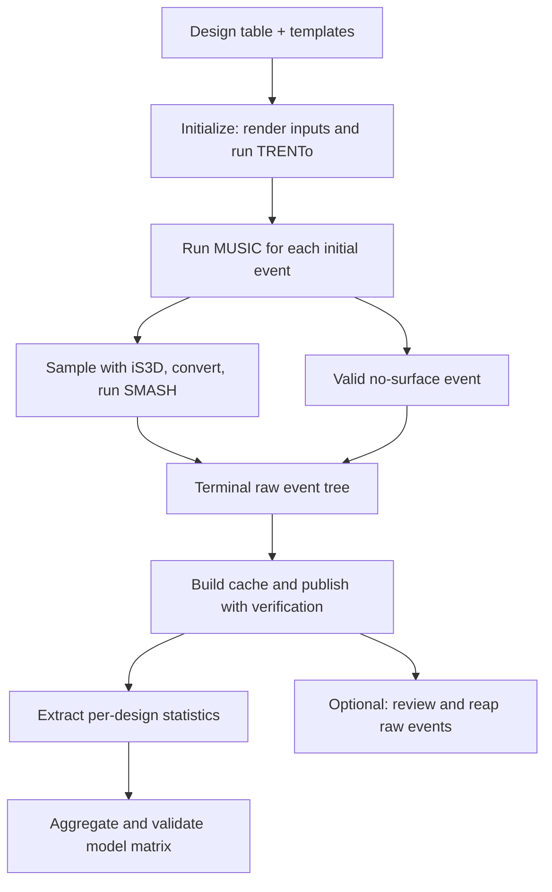

# How the workflow fits together

[Handbook](README.md) · [First run](getting-started.md) · [File reference](reference/files.md)

## The physics chain

| Stage | Physical role | Main input | Main output |
|---|---|---|---|
| TRENTo | Sample fluctuating nuclear geometry and an initial transverse profile | Species/nuclear tables, normalization, width, fluctuation and collision parameters | `initial.hdf`, containing many initial profiles |
| MUSIC | Evolve each profile as viscous relativistic fluid with light/strange chemical occupancy | One profile, `music_input`, custom EOS 18 tables | `surface.dat`, the particlization hypersurface |
| iS3D | Sample hadrons from the surface with viscous corrections and chemical occupancies | Custom 31-column surface, particle and coefficient tables | One or more sampled particle lists |
| OSCAR converter | Translate iS3D samples into the file format SMASH reads | Samples and charge dictionary | `results/oscar_list.dat*` |
| SMASH | Evolve hadronic scattering and decays | Converted samples and `config/config.yaml` | `particle_lists.oscar` or its accepted `.unfinished` variant |
| Cache and analysis | Preserve selected particle statistics and compute observables | Terminal raw events and an analysis fingerprint | Published caches, per-design artifacts, `model_matrix.npz` |

TRENTo runs **during initialization**, before event workers start. The event runner handles MUSIC, iS3D, and SMASH. It cannot replace a missing `initial.hdf`. The converter changes representation; it is not another physical evolution.

## Three different meanings of “event”

A **design point** is one row of the parameter table: one choice of model parameters, with many random collisions at those same parameters. A campaign is a set of such designs. Each design has a directory such as `design_000/AuAu200/`.

A **hydro event** is one initial condition and its fluid evolution. The runner's `--nevents` bounds these events. `--nevents 10000` considers IDs 0–9999; it does not request 10,000 SMASH samples per initial condition. Directory names are zero-padded to `len(str(nevents - 1))`, with a minimum width of one. For two events they are `0/` and `1/`; for 10,000 they are `0000/`–`9999/`.

An **oversample** is an independent iS3D draw from the same hydro surface, followed by SMASH. Oversamples share the initial geometry. The production sampler chooses `min(ceil(10000 / estimated_yield), 10)` samples. Ten is a cap; neither ten samples nor 10,000 actual hadrons is guaranteed. The runner counts complete converted samples and passes that count to SMASH.

Keep the initialized hydro event bound fixed when resuming. Changing it can change both the selected profiles and the event-directory names. Preserve the HDF5 dataset order: event IDs follow the reader's native iteration order, not a new numerical sort of dataset names.

## The four layers of settings

1. **Campaign INI:** paths, selected rows, event bound, resources, repair/cache policy, and analysis settings. Use the same INI throughout a campaign.
2. **Design table and templates:** the parameter row becomes `parameters.dat`; the MUSIC template becomes `music_input`. Existing initialized bundles are preserved when the base template changes.
3. **Runtime environment:** `HIC_*` paths select executables, static tables, conversion script, and archive destinations. Activate the intended profile in every shell and allocation.
4. **Fingerprint and model data:** the fingerprint fixes the cache's observable scope and conventions; approved EOS/particle/coefficient tables fix the physical inputs. These are part of reproducibility, not disposable caches.

The campaign CLI generally overrides INI values, then the backend's defaults apply. This does not mean every CLI spelling is an INI key. Consult the [configuration reference](reference/configuration.md).

## Modes and resuming

| Mode | Where available | Work |
|---|---|---|
| `hydro` | Runner and orchestrator | MUSIC only; creates surfaces/markers for a later afterburner pass |
| `afterburner` | Runner and orchestrator | iS3D → conversion → SMASH on existing hydro surfaces |
| `both` | Runner and orchestrator | Hydro and afterburner in one pass |
| `auto` | `run_designs.py` / `campaign.py events` | Use post-repair `campaign_state.json` to choose `both` or `afterburner` per design, or block ambiguous work |

The runner defaults to `hydro`; generated campaign INIs select `auto`. `--restore-archives` is valid only for the runner's `afterburner` mode. The orchestrator can combine it with `auto` because it selects the concrete mode before submission.

With no overlapping writers, audit/repair interrupted designs, then resume with `python models/campaign.py --config "$CFG" events --submit --allow-existing --no-initialize`. For initialized designs, submit directly from the login node with the profile active; no allocation or `srun` is needed because TRENTo initialization is disabled. Hydro skips existing event directories, so rerunning alone may not recover partial work. Inspect terminal counts and logs after each pass; see [the generation procedure](nersc-campaign.md#1-generate-or-resume-events).

## Where things run

Locally, initialize a small bundle and call `run-events-wrapper` directly. On NERSC, `campaign.py` prepares work and submits Slurm launchers; cache and analysis workers run in CPU allocations. Generation/cache/reap/extraction require `--submit`, while repair/initialization require `--apply`; other commands such as `fill` execute immediately. See [command effects](reference/commands.md#campaign-commands-and-their-effects). OSG stages individual initial conditions on an access point, runs the chain inside a container, and drains output back to NERSC. Its helpers do not consume the INI. NERSC and OSG can share a campaign/raw root while generating disjoint design points, for example progressing through the table from opposite ends with a fixed stopping boundary. Reserve each whole point for one platform; the OSG marker guard does not detect queued/running NERSC jobs. See [OSG setup](../osg/README.md) for the distinction between configuration profiles and the two machines' filesystems.

The generation/cache-analysis workflow ends at validated observables. The separate [inference pipeline](../inference/README.md) handles experimental-data assembly, emulation, Bayesian inference and plotting. Its inputs are described in the [analysis-input reference](reference/analysis-inputs.md).
